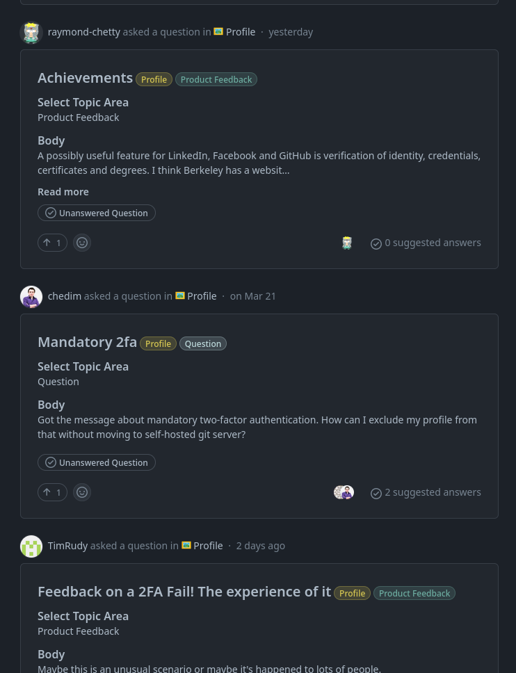
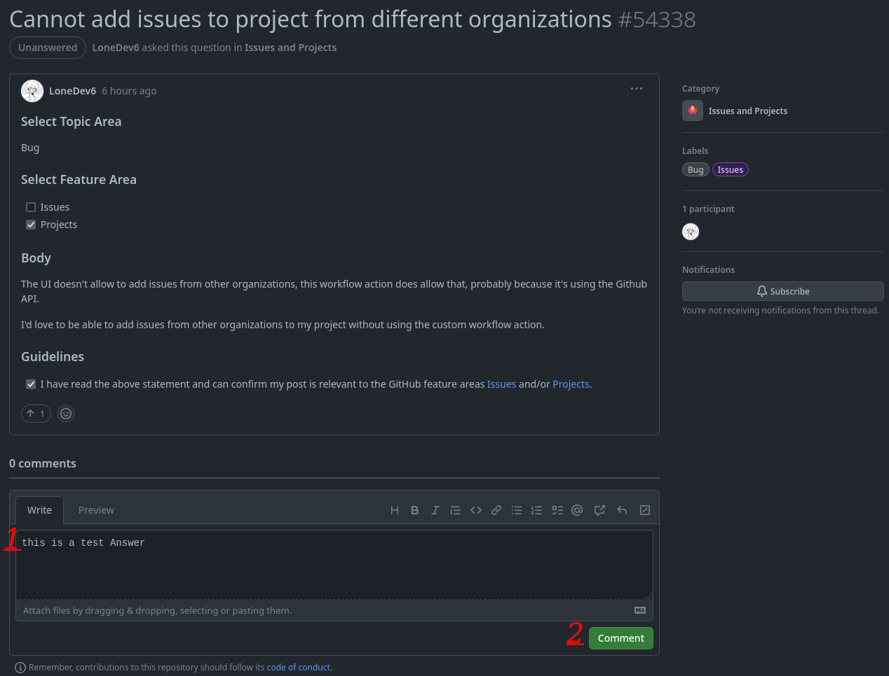
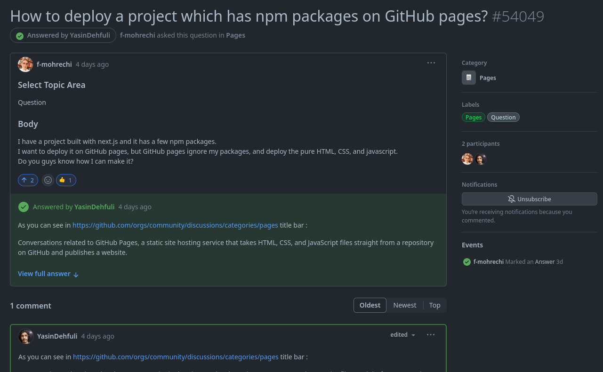
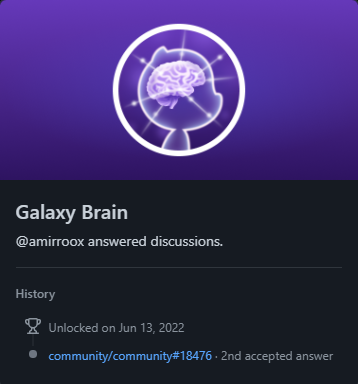

# Galaxy Brain

## ギャラクシーブレイン GitHub アチーブメントをステップバイステップで取得する方法 :

### 1. 任意の公開リポジトリの Discussions タブを開き、Q&A カテゴリ（または回答をマークできる他のカテゴリ）を選択してください。GitHub 公式の Community フォーラムでは実績が無効化されたため、そこでの回答はカウントされなくなりました。

### 2. 今、回答されていない質問を任意のカテゴリで見つける必要があります。そして、その質問に回答してください。

### 3. 質問に正しい回答を記入してください（質問デザイナーによって提出された回答として選択されるためには、あなたの回答が最適なものでなければなりません）

### 4. ギャラクシーブレインのアチーブメントを取得するには、任意のカテゴリで提出された回答が2つ必要です。  

### 5. 完了しました。これで、アチーブメントリストにギャラクシーブレインの達成が表示されます。

