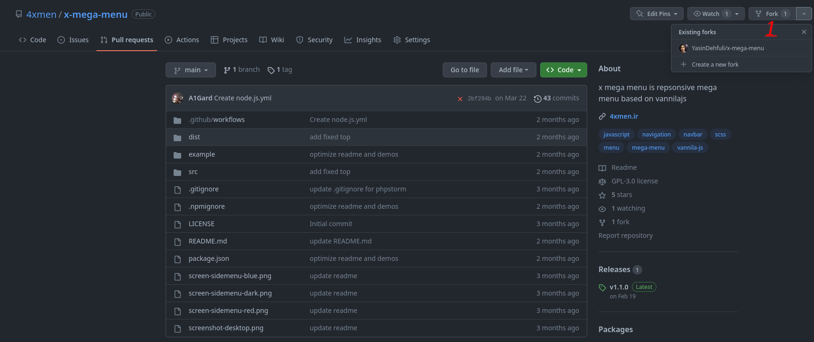
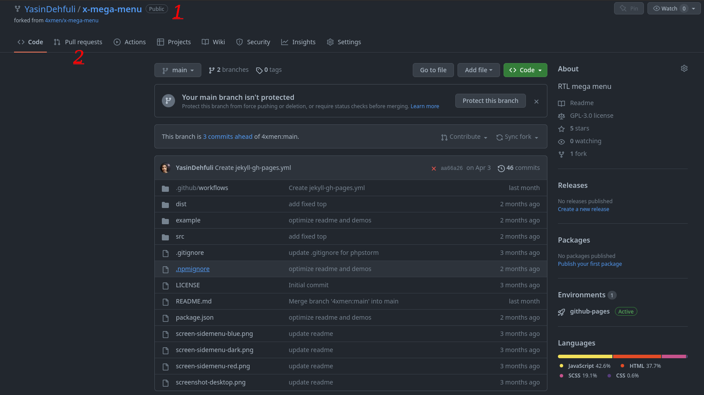
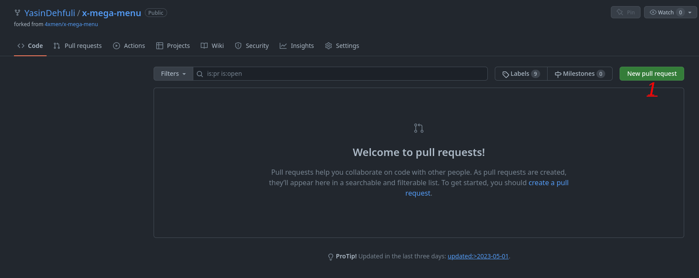
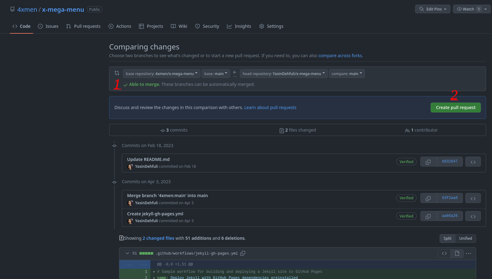
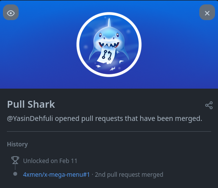

# Pull Shark

## How to get the Pull Shark GitHub achievement step by step

### 1. Fork a repository of your choice.

### 2. Make a change in your fork, such as adding a file or updating existing code. Then open the Pull requests tab.

### 3. Click the Create pull request button.

### 4. Submit your pull request and wait for the repository maintainer to merge it.
#### - You need 2 merged pull requests to get the Pull Shark achievement.

### 5. Once you meet the requirements, the Pull Shark achievement will appear in your achievements list.

